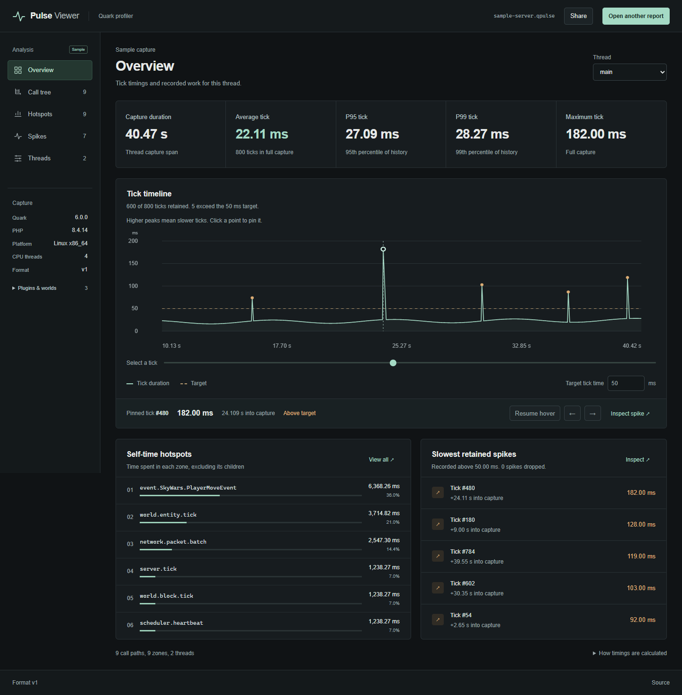

# Pulse Viewer

A static browser viewer for Quark `.qpulse` captures. Reports are processed
locally; their contents are never uploaded. No backend or account is required.

Supports `quark.pulse` **v1**, gzip or UTF-8 JSON, including per-thread captures,
`active_ticks`, and retained spikes. Both input and decompressed output are
limited to 8 MiB, matching Quark. Nanosecond values and counters retain their
64-bit precision.



Explore session metrics, an interactive tick timeline, sortable hotspots,
collapsible call paths, an aggregate flame view, retained spike details, and
separate thread captures. Search with `/`; use the timeline slider or arrow
buttons to inspect ticks. Click a point to pin its details; select **Resume hover**
to follow the pointer again. Tables render 75 rows per page. Flame views show up
to 1,000 scopes and 16 levels, with scope details available in the table.

**Explore sample** opens an explicitly labeled demonstration workload encoded
by Quark, with 800 ticks and two threads. It is not a measured server capture.

**Share** creates a link containing the full capture. Copy it to open the same
report on another device. Anyone with the link can read its metadata and timings.
Capture data stays in the URL fragment; no upload or storage service is used.
Links support up to 48 KiB of compressed data. For larger captures, send the
`.qpulse` file instead. Copy the entire link, as messaging apps may truncate it.
Links created in a local preview only work on that computer; use the hosted
site when sharing with others.

## Development

Requires Node.js 24.13 or newer.

Report viewing requires a current browser with gzip decompression and
[JSON reviver source support](https://developer.mozilla.org/en-US/docs/Web/JavaScript/Reference/Global_Objects/JSON/parse).
Browser tests currently cover Google Chrome.

```sh
npm ci
npm run dev
```

```sh
npm run check
npm run test:browser
npm run benchmark
```

Browser tests use an installed Google Chrome and the production build. Run
`npm run build` first. Tests are in `tests/report.test.ts` (parser and worker)
and `tests/viewer.spec.ts` (browser interactions). Derived analysis regression
tests share the parser test file; no separate testing framework is needed.

The three `.qpulse` fixtures come from Quark's real encoder at revision
`336bbe600124a44ef4fb2bdaf44719909898d7b0`, using PHP 8.4.14. They cover an
empty report, an unfinished capture, and a capture with two threads, nested
zones, wrapped history, retained spikes, and a timestamp beyond JavaScript's
safe integer range. Plain JSON tests decompress the same fixture.
Regenerate fixtures and the sample with `php tools/generate-fixtures.php ../Quark`
(requires Quark's Composer dependencies).

## Static hosting

```sh
npm run build
```

Publish `dist/` to GitHub Pages. Relative asset paths support project URLs such
as `/PulseViewer/`; no server routes are needed. In repository **Settings →
Pages**, select **GitHub Actions** as the source. The single
[workflow](.github/workflows/pages.yml) runs checks and Chrome tests, then
publishes passing pushes to `main`. Pull requests run checks without deployment.
This follows GitHub's [custom workflow setup](https://docs.github.com/en/pages/getting-started-with-github-pages/using-custom-workflows-with-github-pages).

Quark v1 does not store player counts or per-zone percentile samples. Tick
percentiles describe retained history using nearest rank; tick average and
maximum use full capture counters. A thread's capture span is `ended_ns −
started_ns`; `duration_ns` is a configured recording limit. Inclusive times
overlap in nested scopes. Hotspot self times are additive within one thread;
thread times are never presented as combined wall time. Categories use zone
names. Unfinished captures and dropped or unbalanced scopes are identified.
