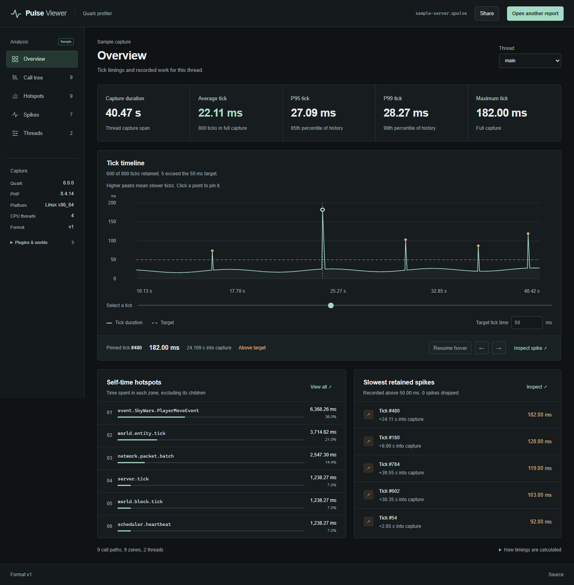

# Pulse Viewer

A static browser viewer for Quark `.qpulse` captures. Reports are processed
locally; their contents are never uploaded. No backend or account is required.

Supports `quark.pulse` **v1, v2, v3 and v4**, gzip or UTF-8 JSON, including per-thread
captures, `active_ticks`, and retained spikes. Both input and decompressed output are
limited to 8 MiB, matching Quark. Nanosecond values and counters retain their
64-bit precision.



Explore session metrics, an interactive tick timeline, sortable hotspots,
collapsible call paths, an aggregate flame view, retained spike details, and
separate thread captures. Search with `/`; use the timeline slider or arrow
buttons to inspect ticks. Click a point to pin its details; select **Resume hover**
to follow the pointer again. Tables render 75 rows per page. Flame views show up
to 1,000 scopes and 16 levels, with scope details available in the table.

Version 3 adds process CPU usage and main-thread PHP heap histories. CPU includes
all server threads; 100% means one core, so peaks can exceed 100%. Summaries cover
retained samples and skip unavailable or sub-second CPU intervals, avoiding false
spikes from coarse system counters. Charts use the retained time range after history
wraps. PHP heap usage excludes native allocations and worker heaps; its sampled
peak can miss brief allocations. Resource history is capped at 1,200 samples,
matching Quark. Older captures remain readable.

Version 4 adds these views and measurements, following Quark's
[report specification](https://github.com/Bedrock-Phanatics/Quark/blob/main/docs/pulse.md).
Captures that lack the data show an explanation instead of zeros.

- **Memory**: main-thread PHP heap (used and allocated) next to process RSS and its
  peak since launch, with charts, a sample table and worker heaps. RSS comes from
  `/proc` on Linux and is blank elsewhere. It includes native allocations, stacks
  and workers, so it is not native heap use. Samples are taken at most once per
  second, so short peaks are missed, and growth is not a leak diagnosis.
- **Plugins**: ranked by measured main-thread time from `zone_owners`. Total counts
  outermost callbacks only, so nested or recursive work is never counted twice, but
  it includes work the callback triggers (other plugins too) and totals can overlap.
  Self excludes nested zones and is additive. Percentages use the capture span.
  Async completions are not attributed to plugins.
- **Async**: submissions, completions, peak queue, submit-to-result and main-thread
  pickup latency, plus per-worker queue wait, run time, busy share and heap. The
  bottleneck notes are heuristics (worker 80% busy or more, average pickup 50 ms or
  more, tasks waiting longer than they run, uncollected tasks, uneven load). Workers
  with no tasks and averages with nothing behind them show dashes, not zero.
- **Network**: Bedwire and RakLib counters (bytes, batches, packets, rejected and
  dropped packets, receive pauses, event stalls, overload disconnects, peak sessions
  and queues). They are totals over the capture, not rates, and a rejection is not
  evidence of an attack. Unknown counters render as recorded and are marked
  unrecognized.

Parsing mirrors Quark's decoder: version-specific field counts, 8-column resource
rows, nullable RSS pairs, ascending unique zone owners, async totals, at most two
transports with up to 64 counters, and the shared 8 MiB, row and text budgets.
Values are `bigint`, so 64-bit counters stay exact.

**Explore sample** opens an explicitly labeled demonstration workload encoded
by Quark, with 800 ticks, two threads and sample network decisions. It is not a
measured server capture or real exploit activity. Its resource readings are illustrative.

**Share** creates a link containing the full capture. Copy it to open the same
report on another device. Anyone with the link can read its metadata and timings.
Capture data stays in the URL fragment; no upload or storage service is used.
Links support up to 48 KiB of compressed data. For larger captures, send the
`.qpulse` file instead. Copy the entire link, as messaging apps may truncate it.
Links created in a local preview only work on that computer; use the hosted
site when sharing with others.

## Development

Requires Node.js 24.13 or newer.

Report viewing requires a current browser with gzip decompression and
[JSON reviver source support](https://developer.mozilla.org/en-US/docs/Web/JavaScript/Reference/Global_Objects/JSON/parse).
Browser tests currently cover Google Chrome.

```sh
npm ci
npm run dev
```

```sh
npm run check
npm run test:browser
npm run benchmark
```

Browser tests use an installed Google Chrome (set `CHROME_PATH` to another
Chromium-based browser if Chrome is not installed) and the production build. Run
`npm run build` first. Tests are in `tests/report.test.ts` (parser and worker)
and `tests/viewer.spec.ts` (browser interactions). Derived analysis regression
tests share the parser test file; no separate testing framework is needed.

The v4 fixtures come from Quark `main`'s own encoder (`PulseContext` and
`PulseReport`), not from edited older files: `full-v4` (every v4 field with
deterministic values: nested and recursive plugin callbacks, a saturated, an idle
and a normal worker, both transports and an unknown counter, a null RSS sample),
`real-v4` (an unmodified capture with real `getrusage` and `/proc` sampling),
`incomplete-v4` (snapshot taken while recording), `minimal-v4` (no owners, no
transports, no RSS, short final CPU interval), `idle-v4` (a thread that never
recorded: `async` and `resources` are `null`) and `empty-v4`.
Regenerate them and the sample with `php tools/generate-fixtures.php ../Quark`
(Quark at `main`, with Composer dependencies). The pre-v4 fixtures below are kept
exactly as originally generated; `tools/generate-legacy-fixtures.php` can
re-derive them for comparison (`live-v1` embeds a wall-clock end time).

The three v1 `.qpulse` fixtures come from Quark's real encoder at revision
`336bbe600124a44ef4fb2bdaf44719909898d7b0`, using PHP 8.4.14. They cover an
empty report, an unfinished capture, and a capture with two threads, nested
zones, wrapped history, retained spikes, and a timestamp beyond JavaScript's
safe integer range. Plain JSON tests decompress the same fixture. A fourth
fixture, `network-v2.qpulse`, comes from the updated Quark encoder and covers network
windows, session phases, signed limiter values and paired decision events.
The v3 fixture, `resources-v3.qpulse`, uses Quark's version 3 encoder with deterministic
CPU and heap readings, an unavailable CPU interval, and a worker without resource data.


## Static hosting

```sh
npm run build
```

Publish `dist/` to GitHub Pages. Relative asset paths support project URLs such
as `/PulseViewer/`; no server routes are needed. In repository **Settings →
Pages**, select **GitHub Actions** as the source. The single
[workflow](.github/workflows/pages.yml) runs checks and Chrome tests, then
publishes passing pushes to `main`. Pull requests run checks without deployment.
This follows GitHub's [custom workflow setup](https://docs.github.com/en/pages/getting-started-with-github-pages/using-custom-workflows-with-github-pages).

Quark v1 does not store player counts or per-zone percentile samples. Tick
percentiles describe retained history using nearest rank; tick average and
maximum use full capture counters. A thread's capture span is `ended_ns −
started_ns`; `duration_ns` is a configured recording limit. Inclusive times
overlap in nested scopes. Hotspot self times are additive within one thread;
thread times are never presented as combined wall time. Categories use zone
names. Unfinished captures and dropped or unbalanced scopes are identified.

## Network evidence

Pulse v2 adds a **Network** view with packet counts, byte totals, decoding
outcomes, session filtering and recorded validation or limiter decisions.
Click a traffic bar to keep its bucket selected, or use the slider with a mouse,
touch or keyboard. Charts show retained bucket counts, including partial final
buckets, rather than assuming complete traffic rates. Large charts show the
busiest bucket in each group; the slider still reaches every retained bucket.

Session IDs are local to each thread and capture. Received bytes measure MCPE
batches before decryption, excluding RakNet framing. Successful decoding can
precede plugin cancellation, so outcome counts overlap. Plugin cancellations
are shown separately from validation failures.

Event rows preserve the reason, action, phase, packet ID, tick, observed value
and the limit or expected value. Rate events compare requested tokens with
available budget, which can be negative. Decompression evidence may be a measured prefix or a
declared length, rather than a complete output size. A rejection followed by a
disconnect can produce two records for one failure; events are not attack counts.

Coverage includes unretained sessions, evicted events and windows, and saturated
counters. Totals describe retained windows; saturation makes them lower bounds.
Unattributed activity may combine multiple unretained sessions. Missing or
evicted data is not reconstructed. Pulse v1 shows telemetry as unavailable.

The viewer reports recorded evidence, not malicious intent or a clean security
result. A specific exploit diagnosis still requires a specific validated rule,
consistent with [OWASP logging guidance](https://cheatsheetseries.owasp.org/cheatsheets/Logging_Cheat_Sheet.html).
